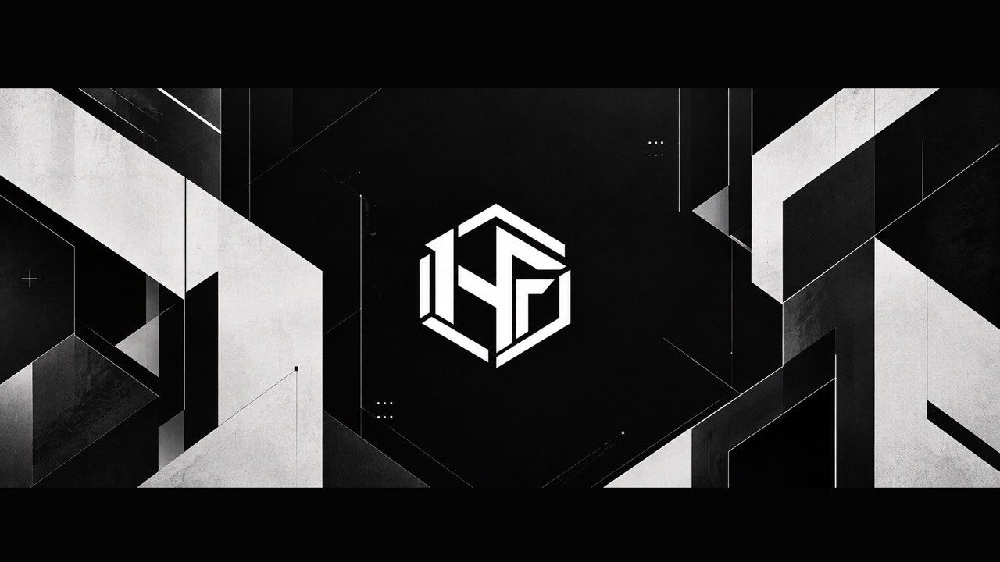

  

   

  <strong>Practical tools for game developers. Native code, thoughtful workflows, no unnecessary complexity.</strong>

    

  
  
  
  
  
  

 

## Featured projects

<table>
  <tr>
    <td width="50%" valign="top">
      <h3><a href="https://github.com/HexForgeDeveloper/Tools-Project">Tools-Project</a></h3>
      
Nine standalone editor plugins for content management, validation, performance analysis, and everyday Unreal workflows.

      
<code>Unreal Engine</code> <code>C++</code> <code>Slate</code>

    </td>
    <td width="50%" valign="top">
      <h3><a href="https://github.com/HexForgeDeveloper/Tools-Plugins">Tools-Plugins</a></h3>
      
Independent, reusable editor plugins that can be integrated into other Unreal projects.

      
<code>Unreal Engine</code> <code>C++</code> <code>Editor Tools</code>

    </td>
  </tr>
  <tr>
    <td width="50%" valign="top">
      <h3><a href="https://github.com/HexForgeDeveloper/Amber-Engine">Amber-Engine</a></h3>
      
A work-in-progress 2D engine with custom physics and separate editor and runtime workflows.

      
<code>C++</code> <code>SDL2</code> <code>Dear ImGui</code> <code>CMake</code>

    </td>
    <td width="50%" valign="top">
      <h3><a href="https://github.com/HexForgeDeveloper/RaycastEngine">RaycastEngine</a></h3>
      
A compact raycasting engine with an SDL2 software renderer and an ImGui map editor.

      
<code>C / C++</code> <code>SDL2</code> <code>Dear ImGui</code>

    </td>
  </tr>
</table>

## Unreal Engine editor toolkit

Nine focused tools, developed together in **Tools-Project** and available individually through **Tools-Plugins**.

| Tool | What it adds |
| --- | --- |
| **[DataAssetManager](https://github.com/HexForgeDeveloper/DataAssetManager)** | Browse, filter, edit, validate, compare, and maintain Data Assets in bulk. |
| **[TextureChannelPacker](https://github.com/HexForgeDeveloper/TextureChannelPacker)** | Pack, repack, unpack, and preview texture channels with reusable presets. |
| **[CppTemplateGenerator](https://github.com/HexForgeDeveloper/CppTemplateGenerator)** | Create native classes from a configurable set of parent-class shortcuts. |
| **ContentBrowserToolkit** | Triage project content with production-oriented Content Browser filters and audits. |
| **OutlinerToolkit** | Extend the Scene Outliner with useful columns, filters, batch actions, and world audits. |
| **PerformanceInspector** | Capture runtime metrics, inspect live graphs, add event markers, and export reports. |
| **UNotepad** | Edit text, source code, JSON, CSV, and Verse without leaving Unreal Editor. |
| **ValidatorX** | Manage Blueprint and Material validators from a searchable validation dashboard. |
| **WireBundle** | Organize Blueprint and Material graph wires with native reroute bundles. |

## Inside the editor

 

  <strong><a href="https://github.com/HexForgeDeveloper/Tools-Project">Explore the tools</a></strong>
  &nbsp;·&nbsp;
  <strong><a href="https://github.com/HexForgeDeveloper?tab=repositories">Browse all repositories</a></strong>

