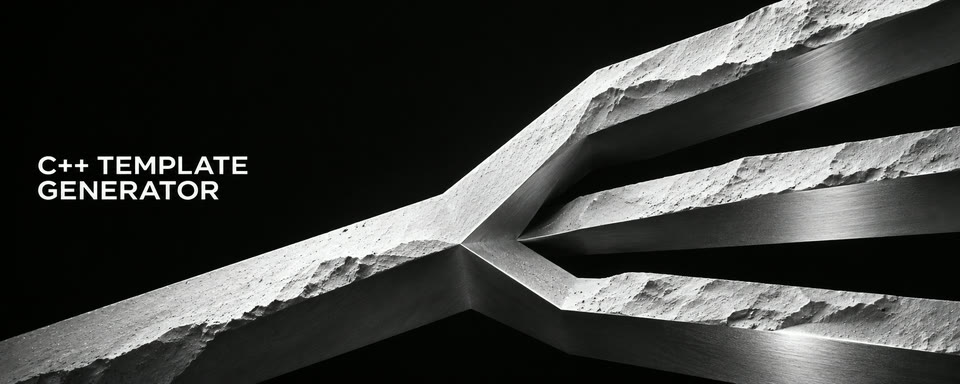
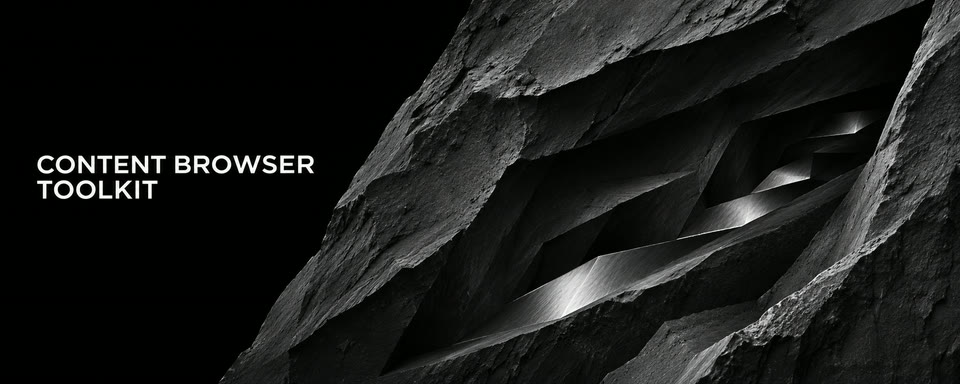
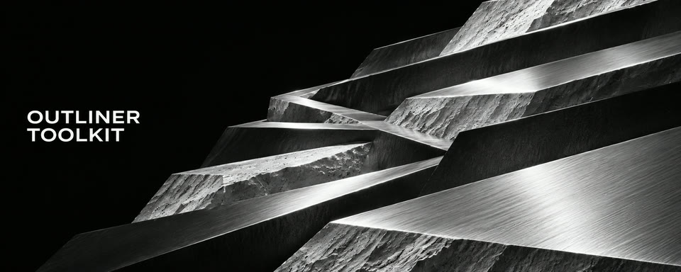
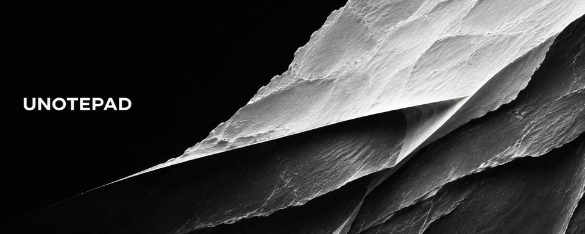

  

   

  <strong>Practical tools for game developers. Native code, thoughtful workflows, no unnecessary complexity.</strong>

    

  
  
  
  
  
  

 

## Featured projects

<table>
  <tr>
    <td width="50%" valign="top">
      <h3><a href="https://github.com/HexForgeDeveloper/Tools-Project">Tools-Project</a></h3>
      
Nine standalone editor plugins for content management, validation, performance analysis, and everyday Unreal workflows.

      
<code>Unreal Engine</code> <code>C++</code> <code>Slate</code>

    </td>
    <td width="50%" valign="top">
      <h3><a href="https://github.com/HexForgeDeveloper/Tools-Plugins">Tools-Plugins</a></h3>
      
Independent, reusable editor plugins that can be integrated into other Unreal projects.

      
<code>Unreal Engine</code> <code>C++</code> <code>Editor Tools</code>

    </td>
  </tr>
  <tr>
    <td width="50%" valign="top">
      <h3><a href="https://github.com/HexForgeDeveloper/Amber-Engine">Amber-Engine</a></h3>
      
A work-in-progress 2D engine with custom physics and separate editor and runtime workflows.

      
<code>C++</code> <code>SDL2</code> <code>Dear ImGui</code> <code>CMake</code>

    </td>
    <td width="50%" valign="top">
      <h3><a href="https://github.com/HexForgeDeveloper/RaycastEngine">RaycastEngine</a></h3>
      
A compact raycasting engine with an SDL2 software renderer and an ImGui map editor.

      
<code>C / C++</code> <code>SDL2</code> <code>Dear ImGui</code>

    </td>
  </tr>
</table>

## Unreal Engine editor toolkit

Explore nine tools from [Tools-Project](https://github.com/HexForgeDeveloper/Tools-Project). The source collection is available in [Tools-Plugins](https://github.com/HexForgeDeveloper/Tools-Plugins).

<table width="100%">
  <tr>
    <td width="33%" align="center" valign="top">
      
       
      <strong><a href="https://github.com/HexForgeDeveloper/DataAssetManager">Data Asset Manager</a></strong>
       
      Browse, compare, and edit Data Assets in bulk.
    </td>
    <td width="33%" align="center" valign="top">
      
       
      <strong><a href="https://github.com/HexForgeDeveloper/TextureChannelPacker">Texture Channel Packer</a></strong>
       
      Pack, remap, and extract texture channels.
    </td>
    <td width="33%" align="center" valign="top">
      
       
      <strong><a href="https://github.com/HexForgeDeveloper/CppTemplateGenerator">C++ Template Generator</a></strong>
       
      Create native classes from configured parent classes.
    </td>
  </tr>
  <tr>
    <td width="33%" align="center" valign="top">
      
       
      <strong><a href="https://github.com/HexForgeDeveloper/Tools-Project/tree/5.5/Plugins/ContentBrowserToolkit">Content Browser Toolkit</a></strong>
       
      Trace asset references and preview folder moves.
    </td>
    <td width="33%" align="center" valign="top">
      
       
      <strong><a href="https://github.com/HexForgeDeveloper/Tools-Project/tree/5.5/Plugins/OutlinerToolkit">Outliner Toolkit</a></strong>
       
      Inspect, organize, and audit scene actors.
    </td>
    <td width="33%" align="center" valign="top">
      
       
      <strong><a href="https://github.com/HexForgeDeveloper/Tools-Project/tree/5.5/Plugins/PerformanceInspector/PerformanceInspector">Performance Inspector</a></strong>
       
      Record frame timings and compare performance budgets.
    </td>
  </tr>
  <tr>
    <td width="33%" align="center" valign="top">
      
       
      <strong><a href="https://github.com/HexForgeDeveloper/Tools-Project/tree/5.5/Plugins/UNotepad">UNotepad</a></strong>
       
      Edit source and data files inside Unreal Editor.
    </td>
    <td width="33%" align="center" valign="top">
      
       
      <strong><a href="https://github.com/HexForgeDeveloper/Tools-Project/tree/5.5/Plugins/ValidatorX">ValidatorX</a></strong>
       
      Review Blueprint and Material validation findings.
    </td>
    <td width="33%" align="center" valign="top">
      
       
      <strong><a href="https://github.com/HexForgeDeveloper/Tools-Project/tree/5.5/Plugins/WireBundle">Wire Bundle</a></strong>
       
      Organize Blueprint and Material wires with native reroutes.
    </td>
  </tr>
</table>

## Inside the editor

 

  <strong><a href="https://github.com/HexForgeDeveloper/Tools-Project">Explore the tools</a></strong>
  &nbsp;·&nbsp;
  <strong><a href="https://github.com/HexForgeDeveloper?tab=repositories">Browse all repositories</a></strong>

